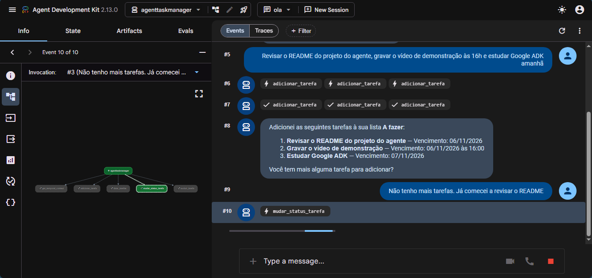
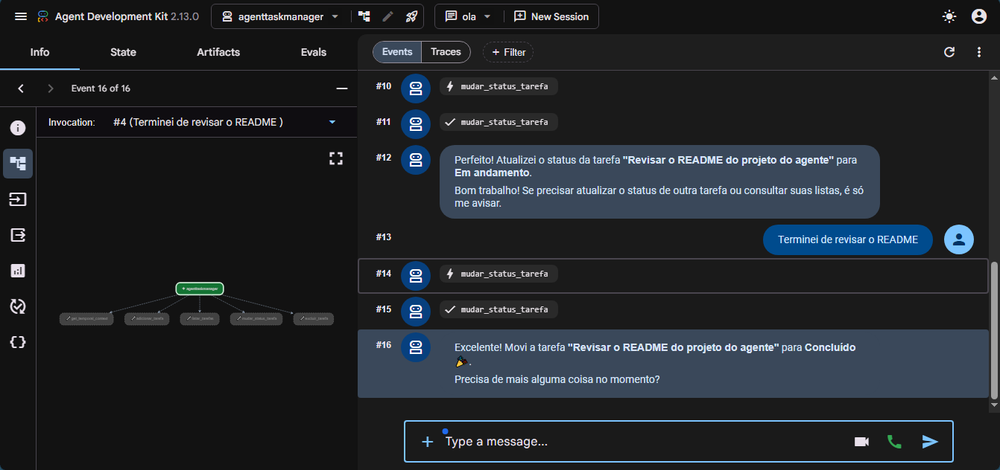
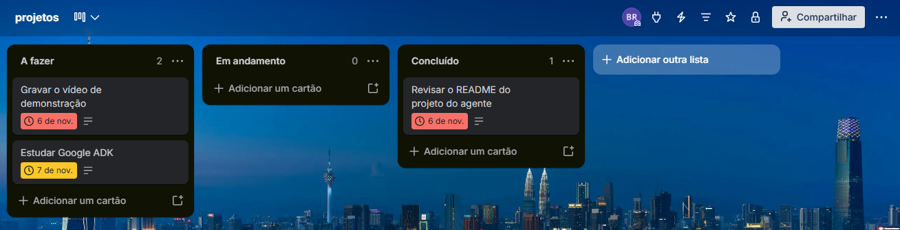

# Agente de Tarefas com Trello (Google ADK + Gemini)

## 1. Apresentação e objetivo

Agente conversacional que organiza as tarefas do dia diretamente em um quadro do Trello. Você conta o que precisa fazer, e ele cria os cards, informa o andamento e move ou exclui tarefas conforme você relata o progresso.

O projeto parte do exemplo educacional da DIO ([`agents/agent04`](https://github.com/digitalinnovationone/agent-carbon-footprint/tree/main/agents/agent04)) e corrige os problemas que encontrei nele (veja [Melhorias implementadas](#9-melhorias-implementadas)).

---

## 2. Arquitetura e tecnologias

```text
Usuário ──► adk web (UI) ──► root_agent (Gemini) ──► tools.py ──► config.py ──► API do Trello
                                    │                    │
                         decide qual tool chamar    5 ferramentas Python
```

| Camada | Arquivo | Responsabilidade |
|---|---|---|
| Agente | [`agenttaskmanager/agent.py`](agenttaskmanager/agent.py) | Modelo, instruções (prompt) e registro das ferramentas |
| Ferramentas | [`agenttaskmanager/tools.py`](agenttaskmanager/tools.py) | Funções chamadas pelo Gemini: criar, listar, mover e excluir tarefas, e informar a data |
| Configuração | [`agenttaskmanager/config.py`](agenttaskmanager/config.py) | Validação do `.env`, fuso horário e conexão única com o Trello |

**Tecnologias:** Python 3.10+, [Google ADK](https://google.github.io/adk-docs/), Gemini (via Google AI Studio), [py-trello](https://github.com/sarumont/py-trello) e python-dotenv. Os testes usam só `unittest` da biblioteca padrão.

```text
trello-ai-agent/
├── agenttaskmanager/      # pacote do agente (o adk web procura por pastas assim)
│   ├── __init__.py
│   ├── agent.py
│   ├── tools.py
│   └── config.py
├── tests/
│   ├── test_tools.py        # unitários, offline (Trello simulado)
│   └── test_integration.py  # ciclo completo no Trello real (opt-in)
├── docs/img/              # capturas de tela
├── requirements.txt
├── .env.exemplo
└── .gitignore
```

> O `agent.py` fica dentro de um pacote (e não na raiz) porque o `adk web` lista como agentes as **subpastas** do diretório onde é executado.

## 3. Funcionalidades e ferramentas

| Ferramenta | O que faz | Exemplo de gatilho na conversa |
|---|---|---|
| `get_temporal_context()` | Data, dia da semana e hora no fuso local | Início da conversa, "amanhã" |
| `adicionar_tarefa(nome, descricao, due_date)` | Cria um card em **A fazer** com título, descrição e data | "Hoje preciso revisar o relatório" |
| `listar_tarefas(status="todas")` | Lista todas as tarefas ou filtra por status | "O que já terminei?" |
| `mudar_status_tarefa(nome, novo_status)` | Move o card entre as listas | "Comecei o relatório" |
| `excluir_tarefa(nome)` | Exclui o card. O agente pede confirmação antes | "Apaga a tarefa da academia" |

O quadro usa três listas: **A fazer**, **Em andamento** e **Concluído**. Se alguma não existir, ela é criada automaticamente. Listas já existentes com nomes em inglês (`To Do`, `Doing`, `Done`) são reaproveitadas.

Todas as ferramentas retornam `{"resultado": "sucesso" | "erro", "mensagem": ..., ...}` e nunca deixam exceções escaparem. Assim o agente consegue explicar o erro em vez de travar.

## 4. Pré-requisitos

- Python 3.10 ou superior
- Conta no [Google AI Studio](https://aistudio.google.com/) (gratuita)
- Conta no [Trello](https://trello.com/) e um board criado para o agente

## 5. Configuração do Google AI Studio

1. Acesse <https://aistudio.google.com/apikey> e clique em **Create API key**.
2. Copie a chave para `GOOGLE_API_KEY` no `.env`.

O modelo padrão é `gemini-3.8-flash`. O `gemini-2.5-flash`, usado no projeto original, retorna *404 "no longer available to new users"* para chaves novas. Para usar outro modelo, defina `GEMINI_MODEL` no `.env` (ex.: `gemini-3.5-flash`).

Se o agente responder com erro **503 UNAVAILABLE** ("high demand"), o modelo está temporariamente sobrecarregado no Google. Espere alguns minutos ou troque o `GEMINI_MODEL`.

## 6. Configuração do Trello

1. **Board:** crie um board (ex.: `Minhas Tarefas`). Coloque o nome exato em `TRELLO_BOARD_NAME`.
2. **API Key e Secret:** acesse <https://trello.com/power-ups/admin>, clique em **New**, preencha nome, workspace e e-mails (a URL de iframe pode ficar em branco) e crie. Na aba **API Key**, gere a chave e copie a **API Key** (`TRELLO_API_KEY`) e o **Secret** (`TRELLO_API_SECRET`).
3. **Token:** abra no navegador a URL abaixo, trocando `SUA_API_KEY`, clique em **Permitir** e copie o token exibido para `TRELLO_TOKEN`:

   ```text
   https://trello.com/1/authorize?expiration=never&name=AgenteTarefas&scope=read,write&response_type=token&key=SUA_API_KEY
   ```

> ⚠️ Trate a API Key, o Secret e o Token como senhas. Eles dão acesso de leitura e escrita aos seus boards.

## 7. Instalação e execução

```bash
git clone <url-deste-repositorio>
cd trello-ai-agent

python -m venv .venv
# Windows (PowerShell):
.venv\Scripts\Activate.ps1
# Linux/macOS:
source .venv/bin/activate

pip install -r requirements.txt

# Configure as credenciais
cp .env.exemplo .env        # PowerShell: Copy-Item .env.exemplo .env
# edite o .env com suas chaves

adk web
```

Abra <http://localhost:8000>, selecione **agenttaskmanager** e envie "oi". O agente responde com a data de hoje e pergunta suas tarefas. (No ADK, o agente só fala depois da primeira mensagem do usuário.)

Se a porta 8000 já estiver em uso por outro projeto (Docker, outra API, outro `adk web`), o navegador vai abrir **o outro app**. Nesse caso, rode `adk web --port 8080` e acesse <http://localhost:8080>.

Se faltar alguma variável, o agente nem carrega e a mensagem de erro informa quais estão faltando.

**Opcional:** `AGENT_TIMEZONE=America/Sao_Paulo` força um fuso específico, útil em servidor/contêiner configurado em UTC. Sem essa variável, o agente usa o fuso do sistema. No Windows, nomes IANA exigem `pip install tzdata`.

## 8. Exemplos de conversa

```text
Você:   oi
Agente: Bom dia! Hoje é sexta-feira, 06/11/2026. Quais são suas tarefas do dia?
Você:   revisar o relatório mensal, ligar para o fornecedor às 15h e academia
Agente: Criei 3 tarefas em "A fazer" para 06/11/2026:
        • Revisar relatório mensal (12:00) • Ligar para o fornecedor (15:00) • Academia (12:00)
        Tem mais alguma tarefa?
Você:   não. Já comecei o relatório
Agente: Pronto! "Revisar relatório mensal": A fazer → Em andamento.
Você:   terminei a ligação
Agente: "Ligar para o fornecedor": A fazer → Concluído.
Você:   o que ainda falta?
Agente: A fazer: Academia (06/11 12:00). Em andamento: Revisar relatório mensal (06/11 12:00).
Você:   apaga a academia, não vou hoje
Agente: Confirma a exclusão definitiva de "Academia"?
Você:   sim
Agente: Tarefa "Academia" excluída.
```

*(Diálogo ilustrativo. As respostas exatas variam conforme o modelo.)*

## 9. Melhorias implementadas

| # | Problema no projeto-base | Solução |
|---|---|---|
| 1 | **Datas com um dia a menos:** `"2026-11-06"` era enviado sem hora nem fuso, e o Trello o interpretava como 00:00 UTC, ou seja, 21:00 do dia **05** no Brasil | A data vira um instante local com offset (`2026-11-06T12:00:00-03:00`). Sem horário informado, usa meio-dia, que tem 12h de folga contra diferenças de fuso. Na leitura, o `due` em UTC é convertido de volta ao fuso local |
| 2 | `datetime.now()` sem fuso nem dia da semana | `get_temporal_context` retorna data, dia da semana, hora e offset no fuso configurado |
| 3 | Status só batia exatamente (`"concluido"` funcionava, `"concluído"` não). Em `listar_tarefas`, um status inválido retornava **tudo** | `normalize_text` remove acentos e maiúsculas. `resolve_status` reconhece sinônimos e frases ("já terminei", "comecei", "done", "ainda não comecei"). Status inválido retorna erro |
| 4 | Sem exclusão, embora o prompt prometesse "remover tarefas" | Nova ferramenta `excluir_tarefa`, com confirmação exigida no prompt |
| 5 | `TrelloClient` e a busca do board repetidos em cada função; board `'DIO'` fixo no código | `config.get_trello_client()` (criado uma vez) e `config.get_board()`, que lê `TRELLO_BOARD_NAME` |
| 6 | Só uma das três ferramentas tinha `try/except`. `[0]` gerava `IndexError` quando o board ou a lista não existia | Todas as ferramentas têm `try/except`, com mensagens específicas para credencial inválida (401), falha de rede, board inexistente etc. |
| 7 | Busca por nome pegava o primeiro card encontrado | Busca exata, depois parcial. Se houver mais de um candidato, o agente pergunta qual é, para não mover nem excluir o card errado |
| 8 | `requirements.txt` instalava `datetime` (um pacote do Zope, não a biblioteca padrão) e `dotenv` (pacote errado) | `google-adk`, `py-trello` e `python-dotenv` |
| 9 | Sem `.gitignore` e sem validação das credenciais | `.gitignore` protege o `.env`. `validate_env()` interrompe a inicialização listando as variáveis ausentes |
| 10 | `gemini-2.5-flash` indisponível para chaves novas (404), e o agente falhava na primeira sobrecarga do modelo (503) | Modelo configurável por `GEMINI_MODEL` e novas tentativas automáticas com espera crescente para 429, 500, 503 e 504 |

## 10. Testes realizados e resultados

### Unitários (offline)

```bash
python -m unittest discover -s tests -v
```

O Trello é simulado com objetos falsos, e o fuso é fixado em UTC-3 para reproduzir o bug de data em qualquer máquina. Os testes cobrem:

- **Criação:** card em "A fazer" com `due` no formato `...T12:00:00-03:00`; listas ausentes criadas; listas em inglês reaproveitadas; nome vazio ou data inválida não criam card.
- **Listagem:** geral, com conversão UTC → local; filtro com variações (`concluído`, `Concluido`, `done`, `feitas`); status inválido retorna erro.
- **Movimentação:** linguagem natural ("comecei", "já terminei"); nome parcial; card que já está no destino; tarefa inexistente; nome ambíguo.
- **Exclusão:** exclui o card; tarefa inexistente ou ambígua não apaga nada.
- **Datas:** regressão do "dia a menos" (o instante continua no mesmo dia em UTC), formato `DD/MM/AAAA`, horário explícito, "hoje" e "amanhã" às 23h30.
- **Erros:** nenhuma ferramenta lança exceção diante de board inexistente, falha de rede ou erro inesperado.
- **Segurança:** `validate_env` lista as variáveis ausentes, e uma varredura confirma que não há credenciais escritas no código.

**Resultado (06/11/2026, Python 3.12, google-adk 2.13.0, py-trello 0.20.1):** `Ran 30 tests — OK (skipped=1)`. Os 29 unitários passaram, e o único teste pulado é o de integração, que exige credenciais.

Também verifiquei que o ADK carrega o agente, que as 5 ferramentas geram schemas corretos para o Gemini (tipos, obrigatórios e defaults) e que o `adk web` lista apenas `agenttaskmanager`.

**Bugs que os testes encontraram e que foram corrigidos durante o desenvolvimento:** o plural "feitas" não era reconhecido como "Concluído", e o teste de integração quebrava a suíte em vez de ser pulado quando não havia `.env`.

### Integração (Trello real)

Cria um card com nome único, confere a data lida de volta, filtra, move por todas as listas, exclui e confirma o erro tratado. O card é removido mesmo se o teste falhar.

```bash
# PowerShell
$env:RUN_TRELLO_INTEGRATION="1"; python -m unittest tests.test_integration -v
# Bash
RUN_TRELLO_INTEGRATION=1 python -m unittest tests.test_integration -v
```

**Resultado (06/11/2026, board real):** ✅ `Ran 1 test in 35.186s — OK`. Foram verificados: criação do card, data lida de volta do Trello igual à data local de hoje (sem o "dia a menos"), listagem geral, filtro "a fazer", movimentação "comecei" → Em andamento → "concluído", filtro "done", exclusão e erro tratado ao excluir de novo.

### Conversa de ponta a ponta (Gemini + Trello)

✅ *Validado no `adk web` (06/11/2026, `gemini-3.5-flash`, board real):*

| Mensagem do usuário | Ferramenta chamada pelo Gemini | Resultado no Trello |
|---|---|---|
| "ola" | `get_temporal_context` | Respondeu com "sexta-feira, 06/11/2026" |
| "Revisar o README…, gravar o vídeo… às 16h e estudar Google ADK amanhã" | `adicionar_tarefa` (3×) | 3 cards em **A fazer**: 06/11 12:00, 06/11 **16:00** e **07/11** 12:00 |
| "Já comecei a revisar o README" | `mudar_status_tarefa` | Card movido para **Em andamento** |
| "Terminei de revisar o README" | `mudar_status_tarefa` | Card movido para **Concluído** |

Conferi o board pela API depois da conversa. As datas e o horário gravados batem com o pedido, sem o "dia a menos".

Na mensagem seguinte, o Gemini respondeu **503 "high demand"**, uma sobrecarga temporária do Google. Para isso, o agente passou a repetir a chamada automaticamente até 5 vezes, com espera crescente (`retry_options` em [agent.py](agenttaskmanager/agent.py)).

### Evidências

**Criação de tarefas a partir de uma única frase:**



**Atualização de status em linguagem natural ("comecei", "terminei"):**



**Quadro do Trello depois da conversa.** Os cards foram criados pelo agente, com as datas certas (06/11 e 07/11), e o README já foi movido para Concluído:



---

Projeto educacional baseado no bootcamp da [DIO](https://www.dio.me/).
